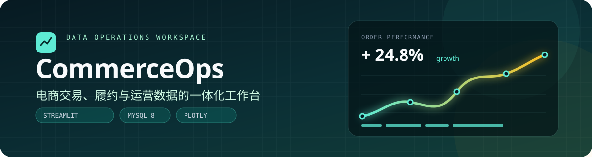
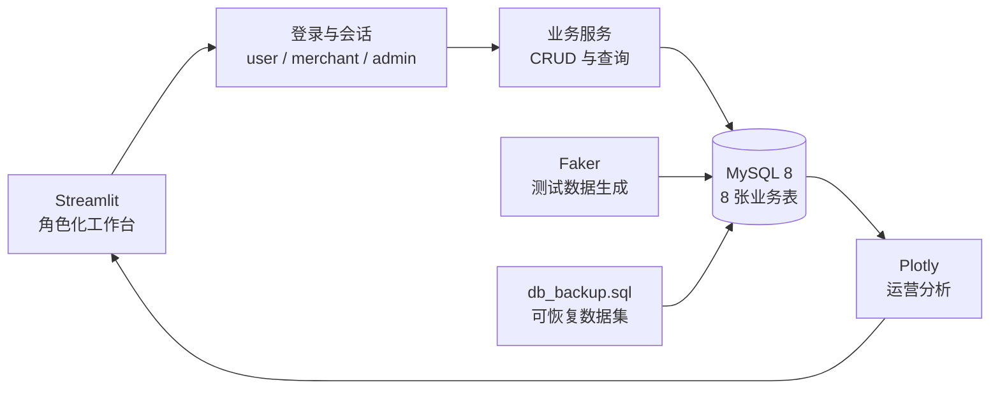

<p align="center">
  
</p>

# CommerceOps · 电商平台数据运营系统

**从交易数据到角色化运营视图，一套可完整运行的电商管理工作台。**

[](https://github.com/LB-Y06/DianShangPingTai/actions/workflows/ci.yml)


[](LICENSE)

## 项目定位

CommerceOps 是一个覆盖**用户、商家、商品、订单、物流、评价与客服**的电商运营原型。它同时解决了数据库设计、测试数据生成、角色权限分流、业务 CRUD 和可视化分析这几类问题，适合作为数据库课程设计、全栈数据项目或运营后台产品原型。

项目不是单纯的图表集合，而是一条完整的数据工作流：初始化 8 张关联表 → 生成可演示的数据 → 按角色进入工作区 → 管理交易 → 汇总运营指标。

## 核心能力

| 模块 | 能力 |
| --- | --- |
| 角色化工作台 | 普通用户、商家、管理员分别进入不同菜单与数据范围 |
| 交易管理 | 商品、订单、物流状态、评价与客服记录 |
| 数据概览 | 用户、商品、订单、完成订单等核心指标 |
| 运营分析 | 品类、订单状态、交易趋势、商品热度与好评率 |
| 数据库生命周期 | 自动建表、外键、触发器、存储过程与 Faker 测试数据 |
| 可复现环境 | Docker Compose 启动 MySQL，配置模板隔离连接信息 |

## 系统架构



## 数据模型

```text
users ─┬─ merchants ─── products ─── orders ─┬─ logistics
       │                                     └─ reviews
       ├─ login_records
       └─ customer_service ─── merchants
```

- `users`：账号、角色、联系方式与创建时间。
- `merchants` / `products`：商家资料与商品库存、价格、品类。
- `orders` / `logistics`：交易主记录与物流履约状态。
- `reviews` / `customer_service`：评价与售后沟通。
- `login_records`：登录审计数据。

数据库通过外键维护关联完整性，并通过触发器在订单完成时同步物流状态。存储过程为商品购买统计和购买趋势提供可复用的数据接口。

## 快速开始

### 1. 启动数据库

需要 Docker Desktop：

```bash
docker compose up -d
```

MySQL 首次启动会自动导入 [`db_backup.sql`](db_backup.sql)，其中包含可直接体验的业务数据。容器内的本地开发密码仅用于演示，不应复用到真实环境。

### 2. 配置并启动应用

```powershell
python -m venv .venv
.\.venv\Scripts\Activate.ps1
pip install -r requirements.txt
Copy-Item config.example.py config.py
streamlit run sql05.py
```

打开 <http://localhost:8501>。演示管理员账号为 `admin`，初始密码为 `admin123`；首次体验后请立即修改。

如果连接自有 MySQL，请编辑本地的 `config.py`，或设置 `MYSQL_HOST`、`MYSQL_USER`、`MYSQL_PASSWORD`、`MYSQL_DB` 环境变量。

### 3. 首次初始化

登录页底部的“系统初始化”区域可以重新建表并生成随机测试数据。已有数据库或已经通过备份导入时，不需要重复执行初始化。

## 项目结构

```text
DianShangPingTai/
├─ sql05.py                # Streamlit UI、业务 CRUD 与分析
├─ config.example.py       # 数据库连接配置模板
├─ docker-compose.yml      # MySQL 8 本地开发环境
├─ db_backup.sql           # 数据库结构与演示数据
├─ mysql2sqlite.py         # 历史数据转换辅助脚本
└─ requirements.txt        # Python 依赖
```

## 验证

```bash
python -m py_compile sql05.py mysql2sqlite.py
docker compose config
```

## 工程说明

- **按角色拆分导航**：页面入口跟随登录身份变化，减少无关操作暴露。
- **数据生成与 UI 分离**：演示数据由 Faker 批量生成，业务页面直接消费数据库状态。
- **可恢复的数据环境**：结构、触发器、存储过程和演示记录都保存在 SQL 备份中。
- **图表服务于运营问题**：品类结构、状态分布、交易趋势和商品反馈形成完整分析路径。

## 生产化建议

当前项目定位为教学与作品展示。用于真实业务前，至少应完成以下改造：

- 将 MD5 密码摘要替换为 Argon2id 或 bcrypt，并加入登录限流。
- 将 Streamlit 会话鉴权替换为成熟的身份认证与授权方案。
- 收紧数据库账号权限，禁用默认管理员密码，并通过密钥管理服务注入配置。
- 补充订单事务边界、并发库存控制和自动化测试。
- 避免把真实业务导出文件直接提交到公开仓库。

## License

代码采用 [MIT License](LICENSE)。仓库中的演示数据为测试数据，不代表真实用户或交易。
